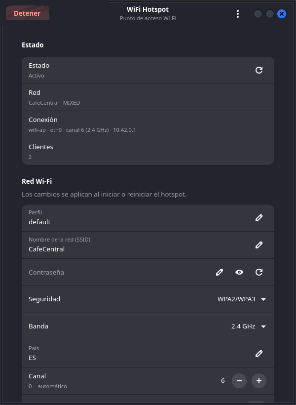

**Español** · [English](README.en.md)

# WiFi Hotspot

[](https://github.com/CarlosDelRosario7/wifi-hotspot/actions/workflows/ci.yml)
[](https://github.com/CarlosDelRosario7/wifi-hotspot/releases)
[](LICENSE)

Gestor moderno y open source de puntos de acceso Wi-Fi para Linux.

WiFi Hotspot convierte un equipo Linux en un punto de acceso Wi-Fi. Funciona en
distintas distribuciones, con una interfaz nativa GTK4 + Libadwaita, un CLI
completo y un daemon privilegiado que permite usar la GUI sin ejecutarla como
root.



> **Estado: 0.1.0 (alfa).** El núcleo, el CLI, el daemon, la GUI y los paquetes
> están implementados y se han probado en Kali Rolling con hardware real en modo
> AP+STA. La bandeja del sistema, el autoarranque del hotspot, la gráfica de
> tráfico y la traducción de la GUI están en la hoja de ruta.

## ¿Por qué otra herramienta de hotspot?

Muchas herramientas existentes dependen de una sola distribución, de un gestor
de red concreto o de una única topología Wi-Fi. WiFi Hotspot soporta:

- **Uplink por Ethernet + AP Wi-Fi** (la configuración más compatible).
- **AP + STA simultáneos en la misma tarjeta** cuando el driver lo permite.
- **Dos tarjetas Wi-Fi** con canal y banda independientes.
- NetworkManager, systemd-networkd o ningún gestor de red.
- `firewalld`, `iptables` y `nftables` como backends de firewall.
- 2.4 GHz y 5 GHz, WPA2, WPA3, WPA2/WPA3 mixto y redes abiertas.
- Debian 13+, Ubuntu 24.04+, Linux Mint 22+, Fedora 41+, Arch Linux,
  Kali Linux y openSUSE Tumbleweed.

## Funciones

- GUI GTK4 + Libadwaita para iniciar, detener y configurar el hotspot.
- CLI con salida legible o `--json`, perfiles y comando `doctor`.
- Daemon root con socket Unix, autenticación `SO_PEERCRED` y polkit.
- Lista de clientes en vivo, señal, contadores RX/TX y expulsión.
- QR para compartir la red desde la GUI o el CLI.
- País/dominio regulatorio, banda, canal, SSID oculto y límite de clientes.
- Subred, rango DHCP, tiempo de concesión, DNS y aislamiento de clientes.
- Perfiles guardados con permisos `0600`.
- Paquetes `.deb`, `.rpm`, AppImage y `PKGBUILD` para Arch.
- Sin telemetría ni conexiones de red salvo los servidores DNS configurados.

## Instalación

### Debian, Ubuntu, Linux Mint y Kali

Descarga el `.deb` desde [Releases](https://github.com/CarlosDelRosario7/wifi-hotspot/releases)
y instálalo con `apt` para resolver las dependencias:

```bash
sudo apt install ./wifi-hotspot_0.1.0_all.deb
sudo systemctl start wifi-hotspotd   # opcional: la GUI también puede iniciarlo
wifi-hotspot-gui
```

El paquete instala `wifi-hotspot`, `wifi-hotspotd`, `wifi-hotspot-gui`, el
wrapper `/usr/bin/wifi.sh`, la entrada de escritorio, el icono, la política
polkit y la unidad systemd. El servicio queda habilitado, pero no se inicia
automáticamente.

### Fedora y openSUSE

```bash
# Fedora
sudo dnf install ./wifi-hotspot-0.1.0-1.noarch.rpm

# openSUSE Tumbleweed
sudo zypper install ./wifi-hotspot-0.1.0-1.noarch.rpm

sudo systemctl start wifi-hotspotd
wifi-hotspot-gui
```

### Arch Linux

El `PKGBUILD` está en `packaging/arch` y usa el tag `v0.1.0` como origen:

```bash
git clone --branch v0.1.0 https://github.com/CarlosDelRosario7/wifi-hotspot.git
cd wifi-hotspot/packaging/arch
makepkg -si
sudo systemctl start wifi-hotspotd
```

### AppImage

El AppImage incluye el CLI y la GUI, pero **no** incluye GTK4, Libadwaita,
PyGObject ni el daemon privilegiado: usa las bibliotecas del sistema. Para que
la GUI pueda iniciar el hotspot necesitas el daemon y la política polkit del
paquete de tu distribución.

```bash
chmod +x WiFi_Hotspot-0.1.0-x86_64.AppImage
./WiFi_Hotspot-0.1.0-x86_64.AppImage            # GUI
./WiFi_Hotspot-0.1.0-x86_64.AppImage doctor     # CLI
./WiFi_Hotspot-0.1.0-x86_64.AppImage --version
```

### Desde el código fuente

Requisitos en Debian/Ubuntu/Kali:

```bash
sudo apt install python3 python3-gi gir1.2-gtk-4.0 gir1.2-adw-1 \
  hostapd dnsmasq-base iw iproute2 iptables nftables qrencode
```

```bash
git clone https://github.com/CarlosDelRosario7/wifi-hotspot.git
cd wifi-hotspot
python3 -m pip install --user .
wifi-hotspot doctor
```

También puedes ejecutar sin instalar:

```bash
PYTHONPATH=src python3 -m wifi_hotspot doctor
PYTHONPATH=src python3 -m wifi_hotspot gui
```

## Uso rápido

Si el daemon está activo, el CLI se comunica con él y polkit pide autorización
cuando hace falta. También puedes ejecutar el motor directamente con `sudo`:

```bash
sudo wifi-hotspot start "MiHotspot" "MiClave123"
wifi-hotspot status
wifi-hotspot clients
wifi-hotspot qr
sudo wifi-hotspot stop
```

Opciones habituales:

```bash
sudo wifi-hotspot start \
  --profile cafe \
  --ssid "CafeCentral" \
  --password "UnaClaveSegura123" \
  --security wpa3 \
  --band 5 \
  --channel 36 \
  --country ES
```

Cuando la AP comparte radio con la conexión STA, el canal del AP debe coincidir
con el de la estación; el motor lo detecta y rechaza un canal incompatible.

Comandos disponibles:

| Comando | Descripción |
| --- | --- |
| `start` | Crea el AP, configura DHCP/NAT y arranca hostapd/dnsmasq. |
| `stop` | Detiene los procesos y limpia interfaces, rutas, firewall y NetworkManager. |
| `restart` | Reinicia el hotspot con la configuración indicada. |
| `status` | Muestra estado, interfaces, canal, firewall y clientes. |
| `clients` | Lista clientes con IP, MAC, señal y tráfico. |
| `doctor` | Diagnostica dependencias, distro, firewall, regdomain y hardware Wi-Fi. |
| `profiles` | Lista los perfiles guardados. |
| `qr` | Muestra el QR del perfil en la terminal. |
| `gui` | Abre la interfaz GTK4. |
| `version` | Muestra la versión. |

Los perfiles se crean y cargan desde la GUI. El CLI puede arrancar con un perfil
existente mediante `--profile NOMBRE`.

## GUI

Abre **WiFi Hotspot** desde el menú de aplicaciones o ejecuta:

```bash
wifi-hotspot-gui
```

La GUI permite:

- Iniciar y detener el hotspot.
- Editar SSID, contraseña, seguridad, banda, canal, país, subred, DHCP, DNS,
  firewall, límite de clientes e IPv6.
- Ver los clientes conectados, su señal y el tráfico acumulado.
- Expulsar un cliente.
- Generar una contraseña segura.
- Mostrar el QR para compartir la red.
- Guardar y cargar perfiles.
- Iniciar el daemon con `pkexec` si no está activo.

La interfaz está en español. La traducción al inglés llegará con el sistema de
traducciones.

## Daemon y seguridad

```
GUI (GTK4)  ──socket Unix──>  wifi-hotspotd (root)  ──>  hostapd / dnsmasq / firewall
CLI         ──socket Unix──>  (o modo directo con sudo)
```

- Socket: `/run/wifi-hotspot/daemon.sock`.
- Estado y PID: `/run/wifi-hotspot`.
- Perfiles y secretos: `/etc/wifi-hotspot`, modo `0700`, archivos `0600`.
- El daemon verifica el UID del par con `SO_PEERCRED`. Root siempre puede; el
  resto pasa por polkit con la acción
  `io.github.carlosdelrosario7.WifiHotspot.manage`.
- La GUI nunca se ejecuta como root.
- Los logs no contienen contraseñas.

```bash
sudo systemctl status wifi-hotspotd
sudo journalctl -u wifi-hotspotd -f
```

## El wrapper `wifi.sh`

El script original se conserva sin cambios en [`legacy/wifi.sh`](legacy/wifi.sh).
`wifi.sh` es un wrapper de compatibilidad que traduce la interfaz antigua al
nuevo CLI:

```bash
sudo ./wifi.sh start "MiHotspot" "MiClave123"
sudo ./wifi.sh stop
./wifi.sh status
./wifi.sh doctor
```

El paquete instala el wrapper como `/usr/bin/wifi.sh`, así que también puedes
usarlo como cualquier otro comando.

### ¿Copiar `wifi.sh` a `/usr/bin` lo convierte en comando?

**Sí, pero copiar solo el archivo no basta.** Linux ejecuta cualquier archivo con
permiso de ejecución que esté en un directorio del `PATH`; por eso un
`wifi.sh` copiado a `/usr/bin` o `/usr/local/bin` se puede invocar por nombre.
Sin embargo, el wrapper necesita encontrar el motor:

1. Primero busca el comando `wifi-hotspot` en el `PATH`.
2. Si no existe, busca `src/wifi_hotspot` junto al propio script.

Si copias únicamente el wrapper a `/usr/bin` sin instalar el paquete, el paso 1
falla y `/usr/bin` tampoco contiene `src/wifi_hotspot`, así que el wrapper
termina con un error. La forma recomendada es instalar el paquete, que ya deja
`/usr/bin/wifi-hotspot` y `/usr/bin/wifi.sh`, o ejecutar `./wifi.sh` desde el
repositorio. Si quieres usar el wrapper desde otra ruta con el código fuente,
crea un enlace simbólico al script del repositorio en lugar de copiarlo:

```bash
sudo ln -s "$PWD/wifi.sh" /usr/local/bin/wifi.sh
```

## Compilar los paquetes

```bash
make check-version   # comprueba que todas las versiones coinciden
make test
make lint
make deb             # dist/wifi-hotspot_0.1.0_all.deb
make rpm             # dist/wifi-hotspot-0.1.0-1.noarch.rpm
make appimage        # dist/WiFi_Hotspot-0.1.0-x86_64.AppImage
make packages        # deb + rpm + appimage
```

Para Arch:

```bash
cd packaging/arch
makepkg -si
```

El AppImage descarga `appimagetool` en la caché del usuario si no está
disponible. El `PKGBUILD`, el `.spec` y el `.deb` usan la misma versión que
`pyproject.toml`; `make check-version` lo verifica.

## Compatibilidad

| Distribución | Estado |
| --- | --- |
| Kali Rolling | Probado en hardware real (AP+STA, 2.4 GHz). |
| Debian 13+ | Objetivo; paquete `.deb` incluido. |
| Ubuntu 24.04+ / Mint 22+ | Objetivo; paquete `.deb` incluido. |
| Fedora 41+ | Objetivo; `.spec` incluido. |
| openSUSE Tumbleweed | Objetivo; `.spec` incluido. |
| Arch Linux | Objetivo; `PKGBUILD` incluido. |

El soporte de AP+STA depende del driver y del firmware. `wifi-hotspot doctor`
muestra las capacidades detectadas. Los reportes de hardware son bienvenidos.

## Arquitectura

```
GUI (GTK4)  ──socket Unix──>  wifi-hotspotd (root)  ──>  hostapd / dnsmasq / firewall
CLI         ──socket Unix──>  (o modo directo con sudo)
```

El núcleo es Python 3.10+ y usa solo la biblioteca estándar. GTK4, Libadwaita y
PyGObject son paquetes del sistema que usa la GUI. Consulta
[docs/architecture.md](docs/architecture.md) para el diseño completo.

## Seguridad

- Los secretos se guardan con permisos `0600` en directorios propiedad de root.
- Las configuraciones no se escriben en `/tmp`.
- El daemon usa un socket Unix local y polkit; la GUI nunca corre como root.
- El firewall usa cadenas y tablas propias para no mezclarse con reglas ajenas.
- Sin telemetría.

Para reportar una vulnerabilidad, lee [SECURITY.md](SECURITY.md).

## Hoja de ruta

1. Bandeja del sistema y autoarranque del hotspot.
2. Gráfica de tráfico e historial de clientes.
3. Traducción completa de la GUI al inglés.
4. Más pruebas en Fedora, Arch, openSUSE y Ubuntu.
5. Base de datos de hardware y drivers compatibles.

## Contribuir

Las contribuciones son bienvenidas. Lee [CONTRIBUTING.md](CONTRIBUTING.md) antes
de abrir un pull request. Los reportes de hardware son especialmente útiles.

## Licencia

Copyright (C) 2026 Carlos Del Rosario y colaboradores.

Este proyecto es software libre: puedes redistribuirlo y/o modificarlo bajo los
términos de la GNU General Public License, versión 3 o posterior. Consulta
[LICENSE](LICENSE).
